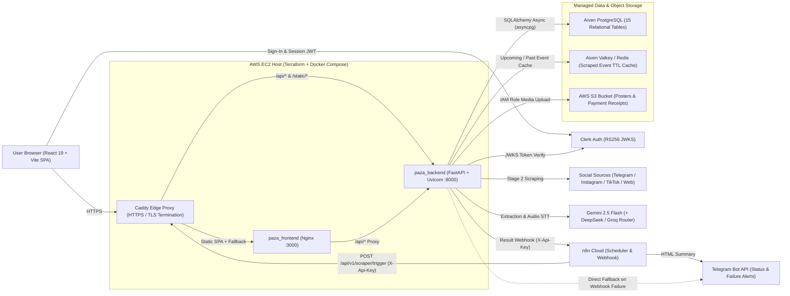
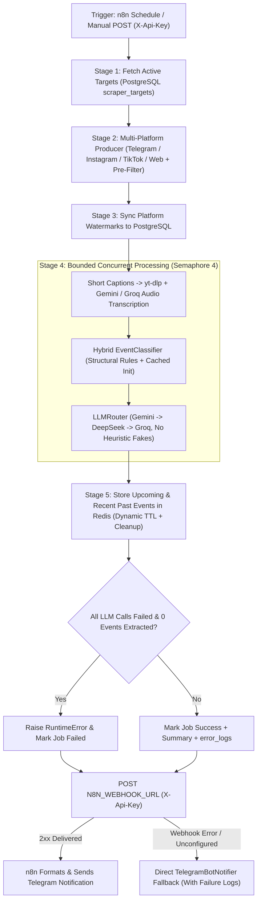
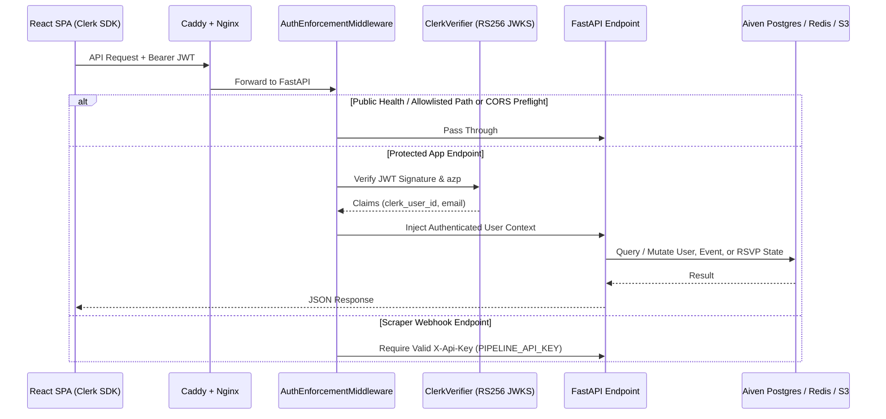
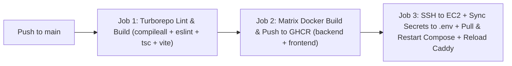

# PAZA — Addis Ababa Event Discovery Platform

Full-stack Turborepo monorepo for **PAZA**, a web platform and automated AI ingestion pipeline for discovering, curating, bookmarking, and RSVPing to live events across Addis Ababa.

---

## High-Level System Architecture



---

## Automated 6-Stage Ingestion & AI Pipeline

Triggered on a schedule or manually via `POST /api/v1/scraper/trigger?async_mode=true` (protected by `PIPELINE_API_KEY` and tracked via `PipelineJobStore` at `GET /api/v1/scraper/jobs/{job_id}`):



### Key Pipeline Design Choices
- **Fail-Closed Extraction:** When `run_pipeline_gateway()` calls `LLMRouter(..., allow_heuristic_fallback=False)`, exhausted LLM retries increment `failed_extractions` and preserve explicit exception types (`{ExceptionType}: {detail}`) instead of polluting Redis with heuristic placeholder cards.
- **Event Loop Protection:** Blocking `yt_dlp` and `instaloader` calls run via `asyncio.to_thread` with explicit socket timeouts so background scraping does not stall API requests.
- **Guaranteed Error Reporting:** Stage 2 target failures, transcription errors, LLM failures, Redis warnings, and outbound `n8n` callback errors (`N8nWebhookClient.last_error`) are aggregated into `error_logs` and rendered as HTML-escaped `Failure Logs` in Telegram alerts.

---

## Request Lifecycle & Auth Architecture



---

## Data Storage Breakdown

| Store | Technology | Role & Contents |
| :--- | :--- | :--- |
| **Primary Database** | PostgreSQL (`asyncpg` + SQLAlchemy ORM) | 15 tables: `users`, `organizers`, `interests`, `user_interests`, `events`, `event_rsvps`, `tickets`, `transactions`, `bookmarks`, `organizer_subscribers`, `hangouts`, `comments`, `comment_upvotes`, `scraper_targets`, `saved_scraped_events` |
| **Event Cache** | Valkey / Redis (`redis.asyncio`) | Scraped AI-extracted event payloads (`event:<platform>:<post_id>`) with automatic TTL expiration and `upcoming` / `past` partitioning |
| **Media Storage** | AWS S3 (`boto3` + IAM EC2 Profile) | Validated raster images (`PNG`, `JPEG`, `WebP`, `GIF`, max `10 MB`; blocks SVG) for organizer posters and Telebirr/CBE payment receipts, with `/static/` local disk fallback |

---

## CI/CD & Cloud Deployment



Infrastructure in [`app/backend/terraform/environments/dev/`](app/backend/terraform/environments/dev/main.tf) provisions the AWS VPC, EC2 host (`t3.micro`, Ubuntu), Elastic IP, security groups, S3 media bucket with public read policy for media objects, and the EC2 IAM instance profile.

---

## Monorepo Layout

```text
paza/
├── .github/workflows/deploy.yml      # Turborepo CI, GHCR matrix build, SSH EC2 deploy
├── docker-compose.yml                # Backend (:8000) & Frontend (:3000) container definitions
├── n8n/paza-scraper-pipeline-workflow.json  # Two-way X-Api-Key n8n workflow template
├── turbo.json                        # Turborepo task pipeline graph
├── package.json                      # Root workspace scripts
└── app/
    ├── backend/
    │   ├── app/
    │   │   ├── api/v1/endpoints/     # health, users, events, organizers, notifications, scraper
    │   │   ├── core/                 # config, clerk JWKS verification, security middleware
    │   │   ├── db/                   # asyncpg engine/session & 15 SQLAlchemy models
    │   │   ├── schemas/              # Pydantic v2 request/response schemas
    │   │   └── services/             # scraper, transcriber, classifier, llm, cache, storage, n8n/tg
    │   ├── terraform/                # AWS VPC, EC2, EIP, IAM, and S3 provisioning
    │   ├── tests/                    # Pytest & IsolatedAsyncioTestCase integration suites
    │   ├── Dockerfile                # Python 3.11 + ffmpeg runtime
    │   ├── .env.example              # Backend environment template
    │   └── requirements.txt
    └── frontend/
        ├── src/
        │   ├── api/                  # Typed fetch client + domain API modules
        │   ├── auth/                 # Clerk AuthProvider wrapper
        │   ├── components/           # Explore cards, AuthGate, InviteCustomizer, Organizer portal
        │   └── pages/                # Route views & saved/RSVP hubs
        ├── Dockerfile                # Multi-stage Node build -> Nginx static runner
        └── nginx.conf                # SPA routing & /api + /static reverse proxy
```

---

## API Overview (`/api/v1`)

| Prefix | Domain | Key Responsibilities |
| :--- | :--- | :--- |
| `/api/v1` | Health | Service readiness & health probe (`health.router`) |
| `/api/v1/users` | Users & Auth | Clerk session bootstrap (`/me`), profile onboarding, interest selection |
| `/api/v1/events` | Events Feed | Unified Redis + Postgres feeds (`/explore`, `/past`, `/for-you`), detail view, RSVPs, ticket QR/code checks, bookmarks, receipt uploads, invite generation |
| `/api/v1/organizers` | Organizer Portal | Organizer onboarding, event publishing, RSVP approval/verification, metrics |
| `/api/v1/notifications` | Notifications | User alert feeds & event updates |
| `/api/v1/scraper` | Scraper Pipeline | API-key-protected `/trigger`, `/jobs/{job_id}`, and `/cleanup` automation endpoints |

---

## Security & Secret Hygiene

- **Fail-Closed Auth:** [`AuthEnforcementMiddleware`](app/backend/app/core/security.py) denies requests by default unless explicitly allowlisted or authenticated via Clerk RS256 JWKS Bearer JWT or constant-time `X-Api-Key`.
- **Header-Only Provider Auth:** External Gemini REST calls authenticate via `x-goog-api-key` headers rather than URL query strings, preventing key leakage in exception traces or HTTP logs.
- **Token Redaction & Bundle Hygiene:** Telegram client errors redact bot tokens before logging; client build config excludes `CLERK_SECRET_KEY`; `.gitignore` and `.dockerignore` exclude all `.env*` (except `.env.example`), `*.pem`, and Terraform state files.
- **Upload Validation:** Poster and receipt uploads verify MIME allowlists and enforce a `10 MB` cap (`413` / `400` on invalid or SVG uploads).

---

## Local Development & Verification

### 1. Environment Configuration
Copy [`app/backend/.env.example`](app/backend/.env.example) to `.env.local` (or `app/backend/.env.local`) and fill in your PostgreSQL, Redis, Clerk, Gemini, Telegram, n8n, and S3 settings. Local dev environment files are gitignored automatically.

### 2. Run Locally (Turborepo)

```bash
# Install root & frontend workspaces
npm install

# Run backend (uvicorn :8000) & frontend (vite :5173) together
npm run dev

# Individual workspace commands
npm run lint
npm run build
npm run dev:backend
npm run dev:frontend
```

### 3. Run Backend Tests

```bash
cd app/backend
.venv/bin/python -m pytest tests/test_clerk_and_n8n.py -v
```

### 4. Local Container Stack

```bash
docker compose up -d --build
docker compose logs -f
docker compose down
```

- **Frontend Container:** `http://localhost:3000` (Nginx SPA + `/api/` & `/static/` proxy)
- **Backend Container:** `http://localhost:8000` (OpenAPI docs enabled when `ENVIRONMENT != production`; disabled automatically in production)
