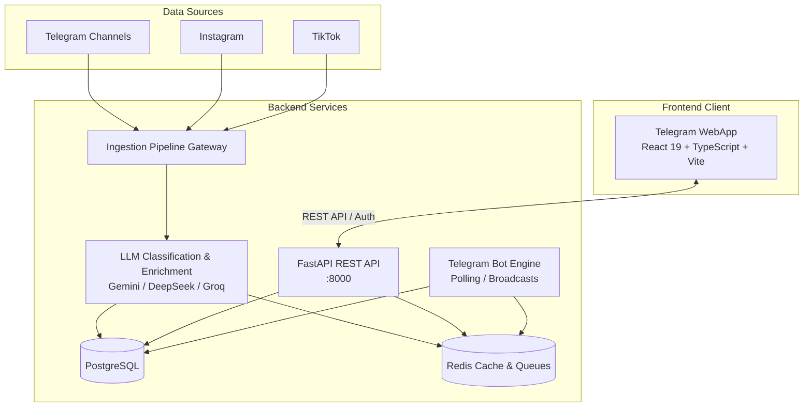

# Paza Monorepo

Welcome to the **Paza** monorepo, containing both the backend services and the Telegram Mini App frontend for discovering, RSVPing to, and sharing events in Addis Ababa.

---

## Repository Structure

```
paza/
├── backend/                  # FastAPI backend server, bot runtime, and ingestion pipeline
│   ├── app/                  # FastAPI endpoints, database models, schemas, and services
│   ├── terraform/            # Infrastructure as Code (dev & prod AWS deployments)
│   ├── tests/                # Backend unit and integration test suite
│   ├── Dockerfile            # Container build specification
│   ├── docker-compose.yml    # Standalone backend service composition
│   ├── requirements.txt      # Python dependencies
│   ├── run_bot.py            # Telegram Bot polling & interaction gateway
│   ├── run_pipeline_gateway.py # Event ingestion & enrichment runner
│   ├── schema.sql            # PostgreSQL database schema
│   └── seed_interests.py     # Default interest tags seed script
├── frontend/                 # Telegram Mini App client (React 19 + TypeScript + Vite)
│   ├── src/                  # React components, pages, hooks, and API clients
│   ├── public/               # Public assets and Telegram WebApp metadata
│   ├── package.json          # Frontend dependencies & build scripts
│   └── vite.config.ts        # Vite configuration
├── docker-compose.yml        # Root Docker Compose for full local stack (Postgres + Redis + API + Bot)
└── package.json              # Monorepo root workspaces & convenience scripts
```

---

## Quick Start & Local Development

### Prerequisites

- **Node.js**: v18+ (v20+ recommended)
- **Python**: 3.11+
- **PostgreSQL**: 15+ (or use Docker Compose)
- **Redis**: 7+ (or use Docker Compose)

---

### 1. Database & Cache (Docker)

To quickly spin up PostgreSQL and Redis:

```bash
docker compose up -d postgres redis
```

---

### 2. Backend Setup

```bash
cd backend

# Create virtual environment
python3 -m venv .venv
source .venv/bin/activate

# Install dependencies
pip install -r requirements.txt

# Configure environment
cp .env.example .env

# Initialize database schema & seed categories
createdb addis_event_db
psql -d addis_event_db -f schema.sql
python seed_interests.py

# Start development server
uvicorn app.main:app --reload --port 8000
```

- **Interactive API Docs (Swagger)**: [http://localhost:8000/docs](http://localhost:8000/docs)
- **Alternative Docs (ReDoc)**: [http://localhost:8000/redoc](http://localhost:8000/redoc)

To run the Telegram Bot:
```bash
python run_bot.py
```

To run the event ingestion pipeline:
```bash
python run_pipeline_gateway.py
```

---

### 3. Frontend Setup

From the repository root (using npm workspaces):

```bash
# Install dependencies
npm install

# Start Vite development server
npm run dev:frontend
```

Or navigate to `frontend/`:

```bash
cd frontend
npm install
npm run dev
```

---

## Root NPM Scripts

| Command | Description |
| :--- | :--- |
| `npm run dev:frontend` | Launch Vite dev server for the Telegram Mini App |
| `npm run build:frontend` | Type-check and build the production bundle |
| `npm run lint:frontend` | Run ESLint checks across the frontend codebase |
| `npm run preview:frontend` | Locally preview the frontend production build |
| `npm run dev:backend` | Start the FastAPI backend with hot reloading |
| `npm run dev:bot` | Start the Telegram Bot poller |
| `npm run test:backend` | Run backend pytest test suite |

---

## Monorepo Architecture Overview



---

## Contributing & Development Workflow

1. Keep backend dependencies strictly managed in `backend/requirements.txt`.
2. Keep frontend packages cleanly configured in `frontend/package.json`.
3. All feature branches should branch from `main`.
